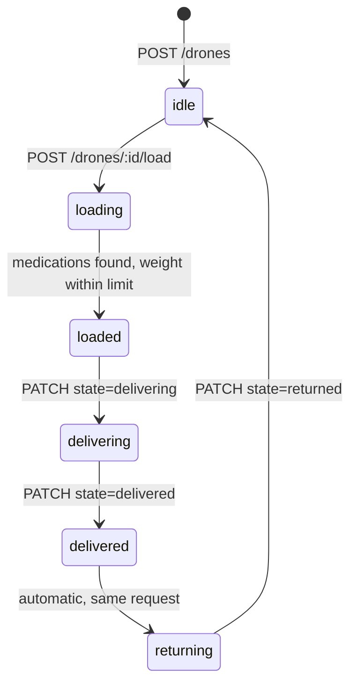

# Drone Dispatch API

A NestJS service for running a small fleet of medication-delivery drones: register drones, load them with medications, and move them through a delivery. The interesting part is the drone lifecycle. Every drone is a state machine, a drone below 25% battery cannot be loaded, a load is rejected if the medications outweigh the drone's limit, and every state change is written to an audit log alongside an hourly battery reading.

## Tech Stack

- NestJS
- TypeScript
- TypeORM
- SQLite
- Swagger (OpenAPI)
- Jest

## Drone lifecycle



Rules enforced by `DroneService`:

- **Loading** requires the drone to be `idle` and its battery to be at least 25%. All medication codes must exist, and their combined weight must not exceed the drone's `weightLimit` (itself capped at 500 g). The whole load is checked before the drone's state changes, so a rejected load leaves the drone `idle`.
- **Delivering** is only allowed from `loaded`.
- **Delivered** is only allowed from `delivering`. The drone's medications are cleared and it moves straight on to `returning` in the same request, so `delivered` shows up in the audit log rather than as a resting state.
- **Returned** is only allowed from `returning` and puts the drone back to `idle`. `returned` is a request value, not a stored state.
- Each transition writes a `STATE_CHANGE` row to the audit log with `{ from, to }` metadata. Registration is the exception: its row holds only `{ toState: "idle" }`.
- An hourly cron job (`@nestjs/schedule`) writes a `BATTERY_CHECK` row with the current battery level for every drone.

The audit log is stored in the database only; there is no endpoint for reading it yet.

## Running it

Requires Node.js 20 or later (NestJS 11) and npm.

```bash
git clone https://github.com/La-BeTe/drone-dispatch-api.git
cd drone-dispatch-api
npm install
cp .env.example .env

npm run start:dev
```

- API: `http://localhost:3000`
- Swagger UI: `http://localhost:3000/docs`
- OpenAPI JSON: `http://localhost:3000/spec`
- Health check: `http://localhost:3000/health`

To load sample data (10 drones with battery levels from 100% down to 20%, and 4 medications), build first, because the seed script runs from `dist/`:

```bash
npm run build
npm run seed
```

The seed script clears the drone and medication tables before inserting.

### Configuration

| Variable   | Value in `.env.example` | Notes                                                                                          |
| ---------- | ----------------------- | ---------------------------------------------------------------------------------------------- |
| `PORT`     | `3000`                  | Falls back to 3000 when unset.                                                                 |
| `NODE_ENV` | `development`           | Schema sync only runs when this is `development`.                                              |
| `DB_SYNC`  | `true`                  | Lets TypeORM create the tables on startup. There are no migrations, so a fresh database needs it. |
| `DB_PATH`  | `./data/db.sqlite`      | SQLite file. When unset, the code defaults to `data/db.sqlite` next to the compiled `app.module`. |

## API

All drone and medication IDs are UUIDs.

| Method | Path                 | Description                                 | Input                                                                 |
| ------ | -------------------- | ------------------------------------------- | --------------------------------------------------------------------- |
| GET    | `/health`            | Health check                                | none                                                                  |
| POST   | `/drones`            | Register a drone (starts `idle`)            | body: `serialNumber`, `model`, `weightLimit`, `batteryCapacity`       |
| GET    | `/drones`            | List drones, paginated                      | query: `state`, `model`, `page`, `limit`                              |
| GET    | `/drones/:id`        | Get a drone with its loaded medications     | none                                                                  |
| PATCH  | `/drones/:id`        | Move a drone through delivery, or set battery | body: `state` (`delivering`, `delivered`, `returned`) or `batteryCapacity` |
| POST   | `/drones/:id/load`   | Load a drone with medications               | body: `medicationCodes` (non-empty array of unique codes)             |
| POST   | `/medications`       | Create a medication                         | body: `name`, `weight`, `code`, `image` (optional)                    |
| GET    | `/medications`       | List medications, paginated                 | query: `droneId`, `page`, `limit`                                     |
| GET    | `/medications/:id`   | Get a medication                            | none                                                                  |
| PATCH  | `/medications/:id`   | Update a medication                         | body: `name`, `weight`, `code`, `image`                               |
| DELETE | `/medications/:id`   | Delete a medication                         | none                                                                  |

Details:

- `model` is one of `lightweight`, `middleweight`, `cruiserweight`, `heavyweight`.
- `weightLimit` is 0 to 500 (grams). `batteryCapacity` is 0 to 100 (percent).
- The `state` filter on `GET /drones` takes any drone state, plus `available`, which returns `idle` drones with at least 25% battery, that is, drones that can be loaded right now.
- `limit` is 1 to 100 and defaults to 10; `page` starts at 1.
- A PATCH to `/drones/:id` that includes `state` ignores `batteryCapacity`. Setting `batteryCapacity` to `0` is allowed.
- Medication `name` allows letters, digits, `-` and `_`. `code` allows upper-case letters, digits and `_`, and is unique.
- `GET /medications?droneId=` lists what a drone is currently carrying.

### Response shape

Responses from the controllers are wrapped by a global interceptor:

```json
{ "success": true, "data": { "id": "…" } }
```

Paginated lists add `meta`:

```json
{
	"success": true,
	"meta": {
		"page": 1,
		"limit": 10,
		"total": 25,
		"totalPages": 3,
		"hasNextPage": true,
		"hasPrevPage": false
	},
	"data": []
}
```

Errors come back with the HTTP status set and a `message` (a string, or an array of validation messages):

```json
{ "success": false, "message": "Battery below 25%" }
```

Requests to routes that do not exist get Nest's default 404 body, not this envelope.

## Scripts

| Script               | What it does                                 |
| -------------------- | -------------------------------------------- |
| `npm run start:dev`  | Start with watch mode                        |
| `npm start`          | Start once via the Nest CLI                  |
| `npm run start:prod` | Run the compiled app from `dist/`            |
| `npm run build`      | Compile to `dist/`                           |
| `npm run seed`       | Load sample data (run `npm run build` first) |
| `npm test`           | Unit tests (Jest)                            |
| `npm run test:cov`   | Unit tests with coverage                     |
| `npm run lint`       | ESLint with `--fix`                          |
| `npm run format`     | Prettier                                     |

Unit tests cover the drone and medication services and controllers with mocked repositories.

## Limitations

- SQLite with `synchronize` and no migrations. Fine for local use, not for a shared deployment.
- No authentication or authorisation.
- Battery level is only what clients report through `PATCH /drones/:id`; nothing drains it during a delivery, and dispatch does not re-check it.
- The audit log has no read endpoint.
- The e2e test in `test/` is still the Nest scaffold and does not match the app's routes.

## Next steps

- Wrap the load and delivery transitions in a database transaction. Validation failures no longer change state, but a database error between the `loading` and `loaded` writes could still leave a drone in `loading`.
- Add migrations and a Postgres configuration.
- Expose the audit log, filtered by drone and event type.
- Model battery use per delivery and refuse dispatch below the threshold.
